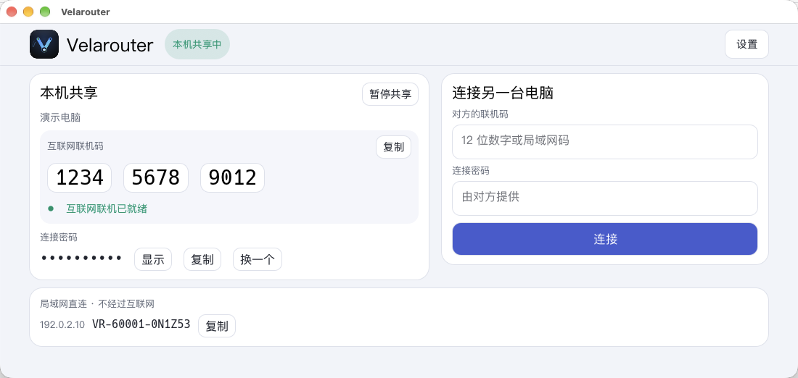
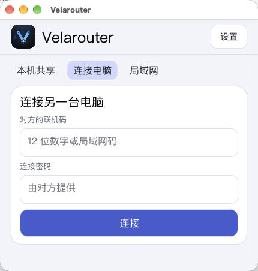

# Velarouter


局域网优先的加密远程桌面。两台电脑装同一个客户端，用联机码和密码连接，无需注册账号。

**[下载安装](https://github.com/logdns/Velarouter/releases/latest)** · **[项目主页](https://2sb.org/Velarouter/)** · **[使用指南](docs/clients/DESKTOP-APP.md)**

[](https://github.com/logdns/Velarouter/actions/workflows/ci.yml)

| 系统 | 下载后怎么用 |
|---|---|
| macOS（Apple Silicon） | 打开 `.dmg`，将 Velarouter 拖到「应用程序」。 |
| Windows x64 | 解压 ZIP，运行 `Velarouter.exe`。 |
| Linux x86_64 / ARM64 | Ubuntu / Debian 优先安装 `.deb`（`amd64` / `arm64`），再从应用菜单启动。其他发行版用 `.tar.gz` 内的 `./install.sh`。 |

## 选哪个客户端

- **桌面**：键鼠、剪贴板、多屏和文件收发。0.1.3 加入最近连接、可选可信设备和四路只读桌面墙。
- **手机浏览器**：在同一可信局域网打开被控端给出的 Web 地址，支持单指操作。不需要原生手机 App；项目主页不是远控入口。
- **终端**：0.1.3 安装包包含 [`velarouter-view`](docs/clients/TERMINAL.md) ANSI 只读预览和 `velarouter` 运维工具。

桌面墙需要两端升级。被控端启用「仅允许可信设备连接」时，需使用已配对的桌面客户端。标准包保持 JPEG；H.264 和 Linux 系统声音只作为源码构建试验。详见 [0.1.3 发布说明](docs/releases/v0.1.3.md)。

## 客户端截图



<details>
<summary>查看窄窗口：通过顶部页签切换</summary>



</details>

截图使用演示设备和联机码。

## 怎么连接

1. 在**被控电脑**打开 Velarouter，将「本机共享」里的联机码和密码发给你信任的人。
2. 在**主控电脑**打开「连接电脑」，粘贴两项，点击「连接」。同一局域网优先使用「局域网」里的 `VR-…` 联机码，密码不变。
3. 需要结束访问时，在被控电脑点击「暂停共享」或「停止共享」。看得到但不能操作时，检查「设置 → 权限」。

局域网直连不需要服务器。跨网默认通过公共会合服务交换加密的连接信息，画面和操作走点对点连接；部分网络（如严格 NAT）可能无法直连，默认不会自动中继。桌面端打开即共享，打包版默认启用开机自启，可在「设置 → 设备」关闭自启。

[查看当前功能与规划](docs/FEATURES.md) · [查看路线图](docs/ROADMAP.md)

## 开发

需要 Rust 1.95+；Linux 先安装[构建依赖](docs/BUILD.md#linux)。

```sh
cargo test --workspace --locked
cargo run --locked -p vr-desktop
```

[项目介绍](docs/OVERVIEW.md) · [文档索引](docs/README.md) · [构建与发布](docs/BUILD.md) · [自建信令](docs/DEPLOYMENT.md) · [维护闭环](docs/MAINTAINER.md) · [安全说明](docs/SECURITY.md)

代码按 [Apache-2.0](LICENSE) 许可发布。品牌使用见[说明](docs/BRAND.md)。
